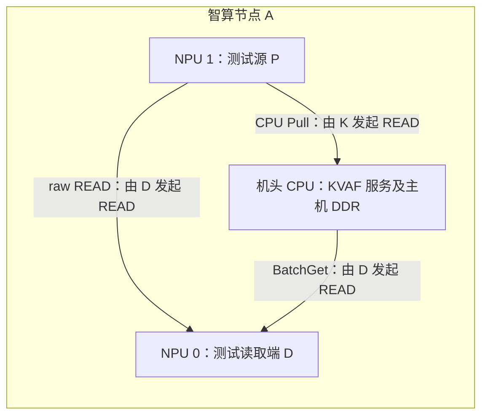

# 昇腾机头 CPU 部署 KVAF：临时 K 节点联调测试

## 1. 目的与当前范围

暂无独立鲲鹏服务器时，在智算节点的**机头 CPU 上运行 KVAF CPU 服务，以该节点的主机 DDR 充当临时 K 池**。NPU 上仍运行 KVAF NpuRuntime/源对象；数据面继续使用 CPU Pull 和 NPU raw READ，不增加 CPU memcpy 替代后端。

本方案用于接口、数据正确性、注册/建链、目录及生命周期联调。它不等同于原设计八台独立 K 的容量、隔离或性能验收。机头 CPU 的具体架构以 `uname -m` 为准，CPU 服务在本机架构上编译。

版本依据：

| 项目 | 分支 / 源码基线 |
| --- | --- |
| 框架 | TX-POC/vllm-ascend-v0.30.0rc2，v0.30.0rc2-develop；组件代码 cef996c1b |
| KVAF | TX-POC/KVAF-Devlop，codex/cpu-pull-hbm-reference；a2f212b2811a40ea2df4351a451381897351dd49 |
| SDK 接口 | 该提交的 docs/connector_pull_api_design.md、cpu_pull_offload_usage.md 和 Python 测试源码 |

**当前可直接进行 SDK 独立联调。完整 PDKVoffloadConnector、Scheduler/Worker/ZMQ、接收区分配和 Runtime 接线尚未完成，因此本指南不宣称当前能启动 GLM5.3 端到端 PD。** 模型接线条件仍见 [实施记录](kvaf_pd_implementation.md)；原部署方法见 [安装、部署与测试](kvaf_pd_install_deploy_test.md)。

机头 CPU 替代 K 不改变已确认契约：每 D worker 独立 Runtime/region、逐层 DDR 几何 `(656,128)`、PA Meta、SDK 解析 UBA、主 KV 满块入 DDR、tail 和完整 Indexer/Scale 入 D HBM，Hot 仅由 Backend 在计算阶段加载。

## 2. 两种临时测试拓扑

### 2.1 T0：同一智算节点内完成联调

同一节点 A 上，机头 CPU 运行 K 服务，选取两张空闲 NPU 分别模拟读取端 D 和生产端 P。当前 SDK 双卡脚本可以直接用于该拓扑。



`127.0.0.1:28999` 只指定控制服务。是否支持同机 CPU↔NPU 的真实 UB/URMA 路径，要通过本文测试确认；TCP 通、同一主机、能访问内存均不能替代 READ 验证。仍需可用 `/dev/uburma`、匹配的 liburma/provider 和正确 EID。

### 2.2 T1：借另一台昇腾机头 CPU 作为远端 K

如果现场 provider 不支持 T0 的同机路径，或希望先验证跨节点 CPU Pull，使用：

| 节点 A | 节点 B |
| --- | --- |
| 两张 NPU 运行 SDK P/D 测试进程 | 机头 CPU 运行 K 服务，分配 B 的 DDR |
| 测试命令 --cpu 指向 B 的实际 IP:端口 | K 监听可达地址，并使用现场 UB candidate |

该拓扑同样不需要独立鲲鹏服务器。现有 SDK 脚本让两个 NPU 测试进程通过同机 Pipe/listener 交换元数据，但 K endpoint 可以在节点 B；因此 T1 能直接沿用同一组测试命令。

T1 **不是**跨主机 P 实例与 D 实例的完整分离部署；后者仍依赖 Connector 接线。测试记录必须写明 T0/T1、实际物理节点和 K 进程数。

## 3. 准备目录和环境

已有源码可直接核对版本，避免覆盖修改。若需新克隆：

```bash
export HOSTCPU_TEST_ROOT="$PWD/kvaf-hostcpu-test"
export KVAF_PD_SRC="$HOSTCPU_TEST_ROOT/sdk"
mkdir -p "$HOSTCPU_TEST_ROOT"

git clone --branch codex/cpu-pull-hbm-reference --single-branch \
  https://github.com/TX-POC/KVAF-Devlop.git "$KVAF_PD_SRC"
git -C "$KVAF_PD_SRC" checkout --detach a2f212b2811a40ea2df4351a451381897351dd49
git -C "$KVAF_PD_SRC" rev-parse HEAD
```

这些变量仅替换文档中的目录、地址和设备，不是新增应用环境开关。K 和 NPU 测试进程使用同一 SDK 提交；可以编译到独立目录，避免旧 SDK 的 `.pth` 或 `PYTHONPATH` 遮蔽。框架的 `scripts/install_kvaf.sh` 固定旧提交，不用于本文的新 Pull SDK。

### 3.1 主机检查

在目标昇腾主机检查，容器场景也检查其实际可见资源：

```bash
uname -m
lscpu -e=CPU,NODE,SOCKET,CORE
numactl --hardware
free -h
ls -l /dev/uburma
ulimit -l
npu-smi info
```

需要：C++17 编译器、CMake 3.18+、与驱动配套的 UMDK 头文件/liburma/provider；NPU 侧需要已配套验证的 torch/torch_npu、CANN。基础 CPU Pull 不需要 AIV kernel 编译器，后续组合测试还需 A5 ccec/ld.lld 和 asc-devkit SIMT 头文件。

`ulimit -l`、provider 权限及实际 pin-memory 能力以现场为准；内存注册失败时同时检查它们。不要仅因主机有 NPU 就认为 CPU 服务的 URMA 环境已就绪。

### 3.2 容器与地址

第一轮可直接在**现有、已映射 /dev/uburma 的 A5 开发容器**中编译并运行 K，K 是独立 CPU 进程，不使用 NPU HBM。NPU SDK 测试在另一终端运行，使用空闲测试卡，先不启动 vLLM TP/EP/HCCL 会话。

| K 与 SDK 的位置 | K 控制监听 | SDK --cpu |
| --- | --- | --- |
| 同一容器 | 127.0.0.1 | 127.0.0.1:28999 |
| 同一主机，双方均 host 网络容器 | 127.0.0.1 或主机可达地址 | 该主机对应地址:28999 |
| 桥接网络或不同网络命名空间 | 按实际容器网络绑定/映射 | 从 SDK 容器实际可达的地址；不是默认认定其 loopback |
| T1 的另一台昇腾主机 | 该主机可达地址或 0.0.0.0 | K 所在主机实际 IP:28999 |

端口示例为 28999，可使用未占用端口。host 网络共享主机端口，先用 `ss -lntp` 核对已有服务。容器内的 SDK 路径按实际挂载重新设置，不能直接照搬宿主机未挂载的路径。

需要进一步隔离 K 时，可使用独立 CPU 服务容器，映射 `/dev/uburma` 和实际依赖的驱动/provider 库，使用原生 Docker 的 `--cpuset-cpus`、`--cpuset-mems`、`--memory` 等限制。容器内仍需确认 liburma/provider 可用；无需为 CPU 服务映射全部 NPU。共享同一容器时，cgroup 内存限制约束的是该容器所有进程，不能当成 K 的独立配额。

### 3.3 CPU、NUMA 和 DDR 预算

机头 CPU 同时服务模型加载、调度、HCCL、tokenization 和 Host 缓冲。第一轮只启动一个 K endpoint，选用空闲 CPU 核；结合 UB 设备、目标 NPU 和可用 DDR 的 NUMA 拓扑填写绑定。不要固定假设 NUMA 0。

```text
可供 K 使用的 DDR <= min(可用主机 DDR, 所属容器/cgroup 剩余额度)
                    - 后续模型加载峰值及新增 Host/pinned 缓冲预留
                    - 其他进程、系统和 provider 开销预留

K 的池需求 = 所有绑定到该 endpoint 的独立 D region 总和 + 元数据/注册等开销
```

DDR 由读取端 Runtime 的 initialize/initialize_ddr 参数申请，CPU 服务没有 `--ddr-size` 参数。`--shm-size` 也不是 KVAF DDR 池配额。

本文单卡和双卡功能脚本各申请 `8×131072 = 1 MiB` 的 DDR region，先用这些小测试排除基础问题。后续模型阶段从一个 D worker、小预算开始，依据真实可用内存和工作负载递增；预算仍按**每 worker 总量**计算。若沿用 4 KiB slot 对齐，单层 128-token 主 KV payload 为 83,968 B，slot 为 86,016 B，另计层数和并发。

## 4. 编译机头 CPU 服务

在 K 进程所在主机/容器的 SDK 根目录：

```bash
cd "$KVAF_PD_SRC"
cmake -S . -B build-hostcpu-k \
  -DCMAKE_BUILD_TYPE=RelWithDebInfo \
  -DKVAF_BUILD_REMOTE_CPU_SERVICE=ON \
  -DKVAF_BUILD_PYTHON=OFF \
  -DKVAF_ENABLE_CPU_OFFLOAD=OFF \
  -DKVAF_ENABLE_AIV_BATCH_GET=OFF \
  -DKVAF_ENABLE_AIV_BATCH_PUT=OFF \
  -DBUILD_TESTING=OFF
cmake --build build-hostcpu-k -j8
ldd build-hostcpu-k/runtime/kvaf_cpu_service
```

UMDK 不在默认目录时，为 cmake 配置命令补上真实的 `-DKVAF_URMA_ROOT=...`，或分别填写 `-DKVAF_URMA_INCLUDE_DIR=... -DKVAF_URMA_LIBRARY=...`。保留对应运行时库搜索路径；`ldd` 无缺失只是基础检查，provider 枚举和实际建链仍需运行验证。

服务可执行文件是本机架构的 CPU 程序，不需要把 NPU kernel 或 CANN Python 装进纯 K 环境。

## 5. 启动 K：单独终端保持前台运行

同机 T0 示例：

```bash
cd "$KVAF_PD_SRC"
export K_LISTEN_IP=127.0.0.1
export K_PORT=28999
set -o pipefail

./build-hostcpu-k/runtime/kvaf_cpu_service \
  --listen "$K_LISTEN_IP" --port "$K_PORT" --memory-page-mode default \
  2>&1 | tee "$KVAF_PD_SRC/hostcpu-k.log"
```

T1 在节点 B 启动时，将 `K_LISTEN_IP` 设为其可达接口地址或 `0.0.0.0`；NPU 客户端使用 B 的实际地址，不能把 `0.0.0.0` 作为 endpoint。

第一轮显式选择已有的 `--memory-page-mode default`，避免主动 MADV_HUGEPAGE 分支干扰。default 不会全局禁用 THP，最终页型仍以现场为准。需要测试 THP 时，完成旧 region 释放和停止后改用 `--memory-page-mode thp` 并重启，记录两轮页面模式；无需修改系统全局 THP 设置。SDK 当前 thp 分支还会预触碰内存，故两种模式的 RSS/时延不能混为一轮结果。

需要固定绑核/NUMA 时，先停止上一个已安全结束的 K 测试进程，在同一终端替换为：

```bash
: "${K_CPUSET:?填写空闲且允许使用的 CPU 列表}"
: "${K_NUMA_NODE:?填写与选定 CPU 和目标资源匹配的 NUMA 节点}"

numactl --physcpubind="$K_CPUSET" --membind="$K_NUMA_NODE" \
  ./build-hostcpu-k/runtime/kvaf_cpu_service \
  --listen "$K_LISTEN_IP" --port "$K_PORT" --memory-page-mode default \
  2>&1 | tee "$KVAF_PD_SRC/hostcpu-k.log"
```

根据日志核对 `CANDIDATE_DISCOVERED` 和 `LISTEN`。必要时追加现场确认的 `--ub-device`、`--eid-index`。不要复制参考机器的 UB 名称/EID。服务启动此时还没有测试 DDR region；后续 NPU Runtime 初始化后才分配。

## 6. 第一步：最小 NPU binding，只测 CPU Pull

在 NPU 测试终端加载现场配套 CANN 环境；以下 source 路径适用于现有 A5 开发镜像，实际不同时按现场路径调整。使用已有 torch/torch_npu 的 Python，不安装 CPU torch wheel。

```bash
source /usr/local/Ascend/ascend-toolkit/set_env.sh
cd "$KVAF_PD_SRC"
python3 -m pip install 'pybind11>=2.13'

cmake -S . -B build-hostcpu-pull \
  -DCMAKE_BUILD_TYPE=RelWithDebInfo \
  -DKVAF_ENABLE_CPU_OFFLOAD=ON \
  -DKVAF_ENABLE_AIV_BATCH_GET=OFF \
  -DKVAF_ENABLE_AIV_BATCH_PUT=OFF \
  -DKVAF_BUILD_PYTHON=ON \
  -DKVAF_BUILD_REMOTE_CPU_SERVICE=OFF \
  -DBUILD_TESTING=OFF \
  -DPython_EXECUTABLE="$(command -v python3)"
cmake --build build-hostcpu-pull -j8

export PYTHONPATH="$KVAF_PD_SRC/build-hostcpu-pull/python${PYTHONPATH:+:$PYTHONPATH}"
python3 -c 'import kvaf; print(kvaf.__file__); assert hasattr(kvaf.NpuRuntime, "submit_cpu_pull")'
```

此构建需要 CANN host runtime，不编译 AIV kernel。`kvaf.__file__` 应指向本次构建；原 `build.sh npu` 未显式打开 CPU_OFFLOAD，本文使用独立 cmake 目录。

### 6.1 一张 NPU → 机头 CPU DDR

T0 在当前测试终端设置；T1 将 endpoint 改为节点 B 的实际可达地址：

```bash
export K_ENDPOINT=127.0.0.1:28999
export TEST_READER_DEVICE=0
export TEST_SOURCE_DEVICE=1
set -o pipefail

python3 tests/python/test_cpu_offload.py \
  --cpu "$K_ENDPOINT" --device "$TEST_READER_DEVICE" \
  2>&1 | tee "$KVAF_PD_SRC/hostcpu-single-npu.log"
```

预期 `LOCAL_CPU_PULL_PASS`、退出码 0；验证三轮变化输入、1/656/100001 B 段、CPU DDR checksum、同步 Commit 和释放。单卡测试无需第二张 NPU或 fullmesh EID。

失败时按顺序核对：地址/命名空间 → liburma/provider → CPU candidate → CPU↔NPU EID → 内存注册和数据 CQ。TCP 成功而 READ 失败时，仍未通过。脚本已有 `--npu-eid` / `--cpu-candidate` 可固定现场发现的路由。

### 6.2 两张 NPU，显式 Prepare/Submit/Wait/Commit

确保两张测试卡不同且空闲：

```bash
python3 tests/python/test_remote_cpu_offload.py \
  --cpu "$K_ENDPOINT" \
  --device-a "$TEST_READER_DEVICE" --device-b "$TEST_SOURCE_DEVICE" \
  --rounds 3 \
  2>&1 | tee "$KVAF_PD_SRC/hostcpu-two-npu-cpu-pull.log"
```

脚本的 device-a 对应 D 读取端，device-b 对应 P 生产端，均在本机通过 multiprocessing 启动。预期 `REMOTE_OFFLOAD_PASS`、退出码 0；检查显式事务、DDR 内容、重复通知、地址所属 region 和源复用确认。

只有一张空闲卡时先完成 6.1 和 CPU UT；不把同一设备号同时填入 a/b 绕过双卡条件。

## 7. 第二步：完整 binding，验证双 Pull 和 Get/Put

先通过第 6 节，再构建独立完整目录。此时需要 A5 ccec/ld.lld、配套 asc-devkit SIMT 头文件，以及两张卡的实际 fullmesh EID。

```bash
cd "$KVAF_PD_SRC"
cmake -S . -B build-hostcpu-full \
  -DCMAKE_BUILD_TYPE=RelWithDebInfo \
  -DKVAF_ENABLE_CPU_OFFLOAD=ON \
  -DKVAF_ENABLE_AIV_BATCH_GET=ON \
  -DKVAF_ENABLE_AIV_BATCH_PUT=ON \
  -DKVAF_BUILD_PYTHON=ON \
  -DKVAF_BUILD_REMOTE_CPU_SERVICE=OFF \
  -DBUILD_TESTING=OFF \
  -DPython_EXECUTABLE="$(command -v python3)"
cmake --build build-hostcpu-full -j8

export PYTHONPATH="$KVAF_PD_SRC/build-hostcpu-full/python${PYTHONPATH:+:$PYTHONPATH}"
python3 -c 'import kvaf; print(kvaf.__file__); assert hasattr(kvaf.NpuRuntime, "batch_get_raw_addr")'
ls build-hostcpu-full/bin/kvaf_execute_batch_get_kernels.o \
   build-hostcpu-full/bin/kvaf_execute_batch_put_kernels.o \
   build-hostcpu-full/bin/kvaf_execute_batch_get_raw_addr_kernels.o

: "${D_FULLMESH_EID:?填写读取端的实际 fullmesh EID}"
: "${P_FULLMESH_EID:?填写生产端的实际 fullmesh EID}"

python3 tests/python/test_hbm_read_raw_addr.py \
  --cpu "$K_ENDPOINT" \
  --device-a "$TEST_READER_DEVICE" --device-b "$TEST_SOURCE_DEVICE" \
  --npu-eid-a-raw "$D_FULLMESH_EID" --npu-eid-b-raw "$P_FULLMESH_EID" \
  --batch-get-kernel "$KVAF_PD_SRC/build-hostcpu-full/bin/kvaf_execute_batch_get_kernels.o" \
  --batch-put-kernel "$KVAF_PD_SRC/build-hostcpu-full/bin/kvaf_execute_batch_put_kernels.o" \
  --raw-kernel "$KVAF_PD_SRC/build-hostcpu-full/bin/kvaf_execute_batch_get_raw_addr_kernels.o" \
  --rounds 3 \
  2>&1 | tee "$KVAF_PD_SRC/hostcpu-dual-pull.log"
```

预期 `HBM_RAW_PASS`、退出码 0。该脚本校验 CPU Pull、同 Runtime 普通 BatchPut/BatchGet、HBM raw READ、源注册和复用。CPU↔NPU EID 与 fullmesh EID 分开填写；必要时用脚本已有 `--npu-eid-a` / `--npu-eid-b-cpu` / `--cpu-candidate` 固定 CPU 路由。

Python binding 和 Get/Put/raw object 来自同次 SDK 构建；raw 使用 V2 ABI。该测试的 payload 是专用测试数据，并非 GLM 主 KV/Indexer/tail 的模型交接。

## 8. 联调验收和资源观测

### 8.1 验收顺序

| 步骤 | 通过条件 |
| --- | --- |
| K 启动 | 选定机头 CPU 上服务监听，provider 枚举正常 |
| 单卡 CPU Pull | LOCAL_CPU_PULL_PASS；checksum、Commit 和释放成功 |
| 双卡 CPU Pull | REMOTE_OFFLOAD_PASS；共享 region、显式事务和源复用正确 |
| 双 Pull + Get/Put | HBM_RAW_PASS；两个源的数据、目标 output 和普通 DDR Get/Put 校验通过 |
| PD 组件逻辑 | 新增 43 项/总回归 121 项 CPU UT 通过，版本按原指南 |
| 全模型接线后 | 再检查 GLM5.3、MTP3、真实层/块地址、完成门控及普通接收区；当前尚未完成 |

CPU UT 命令见 [原指南第 3 节](kvaf_pd_install_deploy_test.md#3-a当前-cpu-安装与-ut)，不需要 K 服务。源码使用新 PD 的逐层 Backend，不修改全局四层分组。

GLM 后续接线用例以实际 Meta 的有效 N 为准：N=127 不写主 KV DDR；N=128 写 83,968 B/层且无 tail；N=300 写两个主 KV 满块 167,936 B/层，tail 44 token、28,864 B/层进 D HBM，Indexer+Scale 39,600 B/层进 D HBM，84 个 padding token 不传。当前 SDK PASS 标记不替代这些模型场景。

### 8.2 机头 CPU 共享资源观测

在重复请求、模型加载和并发阶段记录：MemAvailable、K RSS、swap、CPU 核占用、NUMA 分布、容器内存余量，以及 NPU/HCCL 等待情况。现场从 `ss -lntp` 等输出确认 K PID，再使用可用工具观察：

```bash
: "${K_PID:?填写本次 K 服务 PID}"
numastat -p "$K_PID"
pidstat -r -u -p "$K_PID" 1
```

共享机头 CPU/DDR 会改变调度和通信表现，模型权重加载时尤其需要重新核对余量。多 worker 后，每个 D 仍有独立 Runtime/region；使用一个 K endpoint 可以承载多个 region，但不能共享同一个本地 Put 句柄或重复分配/释放同一批 key。

### 8.3 小规模传输性能

正确性通过后再执行，先只占用少量 DDR/HBM：

```bash
cd "$KVAF_PD_SRC"
python3 tests/python/bench_remote_cpu_offload.py \
  --cpu "$K_ENDPOINT" \
  --device-a "$TEST_READER_DEVICE" --device-b "$TEST_SOURCE_DEVICE" \
  --blocks 16 --block-bytes 83968 --warmup 3 --iterations 10

python3 tests/python/bench_hbm_read_raw_addr.py \
  --device-a "$TEST_READER_DEVICE" --device-b "$TEST_SOURCE_DEVICE" \
  --npu-eid-a-raw "$D_FULLMESH_EID" --npu-eid-b-raw "$P_FULLMESH_EID" \
  --raw-kernel "$KVAF_PD_SRC/build-hostcpu-full/bin/kvaf_execute_batch_get_raw_addr_kernels.o" \
  --packets 16 --packet-bytes 83968 --source-space-bytes 8388608 \
  --warmup 3 --iterations 10
```

检查 `CPU_PULL_BENCH_PASS` 和 `NPU_HBM_BENCH_PASS`。上述 CPU benchmark 的 DDR region 为 16×86,016 B；另计元数据/provider 内存。计时分别是 Python Prepare→Commit 和 raw READ 调用区间，不是纯链路吞吐，也不是模型性能。

记录 T0/T1、CPU/NUMA、page mode、EID、负载和实际字节数。同机 DDR、两节点机头 CPU 和八台远端 K 的结果分别保存，不能外推同等性能。阶段诊断使用独立测试汇总，不向推理热路径加入频繁日志。

## 9. 故障、退出与后续接线

| 现象 | 处理方向 |
| --- | --- |
| 服务无法枚举 provider/candidate | 检查 /dev/uburma、liburma/provider 版本、驱动和容器可见性 |
| 127.0.0.1 连接失败 | 核对双方网络命名空间、实际监听和端口 |
| 控制连接成功但本机 READ 失败 | 核对 EID/candidate、local CPU↔NPU 路径及 provider 支持；可改用 T1 验证远端机头 CPU |
| CPU DDR 注册/分配失败 | 检查主机与容器余量、NUMA 绑定、pin-memory/权限和 provider；核对实际 region 预算 |
| 缺少 CPU Pull 类/方法 | CPU_OFFLOAD 开关、SDK SHA、当前导入路径及旧 .pth |
| raw READ 建链失败 | 独立 fullmesh EID、同次构建的 V2 object 和源/目的设备 |
| Busy、提交超时或确认丢失 | 保留原 Put/Ready、查询/等待或 resolve 原事务；不新建 Put 重放、不提前释放 |
| REMOTE_OFFLOAD_RETAIN | 脚本正在保留未决资源；先核对 DMA/确认状态，不能把保留进程当成功退出 |

退出顺序：停止新提交 → 完成/恢复原 Put 和 raw READ → release batch → D detach → P source shutdown → D Runtime/DDR 关闭 → K 服务最后停止。不要通过先重启 K 或超时释放源内存来跳过在途 DMA；K 重启产生新代次，旧 ticket/地址不能继续使用。

进入真实 vLLM TP/DP/EP 联调前，还需完成新 Connector/Runner 接线、真实逐层 arena/接收区、MTP 与错误/抢占释放，以及目标 SDK 的 RA/HCCL 兼容。旧 Adapter 的 `reuse_device_ra` 签名差异仍存在，机头 CPU 部署不解决它。

联调记录保存：SDK/框架/镜像版本、T0/T1、机头 CPU 架构、设备号/EID、监听和实际 endpoint、NUMA/CPU 绑定、DDR 配额与峰值、每条命令退出码、PASS 标记及 K 日志。**本文硬件步骤待现场执行，当前云环境未实测同机 URMA、CPU/NPU 数据面或模型 PD。**

文档校验：11 段 Bash 示例通过语法检查，5 条 SDK 测试/压测命令的参数与固定提交源码匹配；Markdown 格式、codespell 和 typos 检查通过。这些是文档检查结果，不是硬件命令执行结果。
