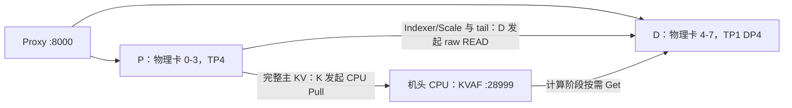

# 单机 8 卡、4 层模型、机头 CPU KVAF：PD 部署准备与验收教程

## 1. 适用范围与当前状态

使用用户已确认能正常运行的 GLM5.3 W4A4C8 四层模型，不修改模型权重、量化方案或原生核心代码。目标是在同一服务器中隔离 P/D 两组 NPU，以机头 CPU DDR 作为临时 K 池。

**当前 v0.30.0rc2-develop 仍只有 PD 地址、注册、事务、完成门控和 Backend 组件，没有可启动的 PDKVoffloadConnector。不能仅靠启动参数完成本方案。** 本文给出可执行的环境/K 准备，以及接线完成后的准确拓扑、配置要求和验收流程；P/D 启动命令需在第 5 节代码接线完成后提供。

框架组件基线为 cef996c1b；SDK 参考为 codex/cpu-pull-hbm-reference 的 a2f212b2811a40ea2df4351a451381897351dd49。详细实现状态见 [实施记录](kvaf_pd_implementation.md)。

用户现场已反馈以下 SDK 测试通过：LOCAL_CPU_PULL_PASS、REMOTE_OFFLOAD_PASS、HBM_RAW_PASS。这验证了测试所用设备和配置下的 CPU Pull、NPU raw READ、共享 DDR 与 Get/Put；不代表完整模型 PD 已接通。这些现场结果并非本云环境的硬件实测。

## 2. 推荐的单机卡分配

| 角色 | 宿主机物理卡 | 目标并行配置 | 规划服务端口 |
| --- | --- | --- | --- |
| P | 0、1、2、3 | TP4 / DP1，启用 EP 时组规模为 4 | HTTP 8100 |
| D | 4、5、6、7 | TP1 / DP4，本地 DP4，启用 EP 时组规模为 4 | HTTP 8200 |
| K | 机头 CPU / 主机 DDR | 一个 CPU 服务，四个 D worker 各有独立 Runtime/region | 已使用的 28999 |
| Proxy | 机头 CPU | 复用原生 P/D 请求路由 | HTTP 8000 |

这是单机联调建议，不改变原两台 P/两台 D 的生产拓扑。P/D 是两个独立模型进程组，EP 不跨 P/D 合并为一个 EP8 组，也不额外占用八张卡。

四层指用于本教程统计的四个 Target 主干层；MTP 所需缓存仍按实际模型注册，不把 MTP3 等同于额外三个独立主干层。已有四层模型的可运行配置作为基线，接线时保留已确认 MTP3。



如果 P 进程设置 ASCEND_RT_VISIBLE_DEVICES=0,1,2,3，D 进程设置为 4,5,6,7，则两组进程内的逻辑设备均可从 0 开始。D 的逻辑 0 对应物理 4，EID 和现有 cpu_addresses 的物理 ID 映射必须据此核对。

同一 K endpoint 可以承载四个独立 region，不能让四个 D worker 共用一个本地 Runtime/Put 句柄。一个请求由 P 的实际 TP 贡献组传到选中的 D worker，而不是广播到四个 D 副本。

## 3. 当前可以执行的环境准备

### 3.1 固定已验证的 Python 环境

按用户现场反馈使用 Python 3.12.13、torch 2.10.0+cpu、torch_npu 2.10.0.post7。torch 的 +cpu 后缀可以与 torch_npu 配合，沿用已成功测试的环境。

在各终端按实际目录设置：

```bash
export KVAF_PD_SRC=/home/c00612283/kvaf-hostcpu-test/sdk
export NPU_PYTHON=/usr/local/python3.12.13/bin/python3
export K_ENDPOINT=127.0.0.1:28999

"$NPU_PYTHON" -c 'import sys, torch, torch_npu; print(sys.executable); print(sys.version); print(torch.__version__, torch_npu.__version__)'

git -C "$KVAF_PD_SRC" rev-parse HEAD
```

当前最小 CPU Pull binding 在 build-hostcpu-pull-py312 中。组合测试应使用现场真正生成 HBM_RAW_PASS 的**完整构建目录**，其中应同时有 Get/Put/raw object，不能把最小 binding 当作完整算子构建。Python 扩展必须是 cpython-312；旧 cpython-311 目录不用于此解释器。

完整 binding 的构建方法见 [机头 CPU 指南第 7 节](kvaf_pd_ascend_host_cpu_test.md#7-第二步完整-binding验证双-pull-和-getput)，其中 Python_EXECUTABLE 必须指向本节的 NPU_PYTHON；若旧构建目录绑定其他 Python，使用新的构建目录。

### 3.2 K 服务

既有测试已通过时，先核对当前服务，不重复启动占用同一端口的进程：

```bash
sudo ss -lntp 'sport = :28999'
pgrep -af kvaf_cpu_service
```

若还未启动 K，在 SDK 根目录、独立终端执行：

```bash
cd "$KVAF_PD_SRC"
./build-hostcpu-k/runtime/kvaf_cpu_service \
  --listen 127.0.0.1 --port 28999 --memory-page-mode default
```

使用现场已验证的页面模式、UB device/candidate/EID 与 NUMA 绑定；上面 default 是最小示例。若现场 PASS 使用其他模式或显式参数，保留其配置。K 进程保持运行，测试期间不要先重启持有活跃 region 的 K。

只有 K 与 P/D 处于同一网络命名空间，或都使用 host 网络时，loopback 地址才能按本例复用。桥接容器应改用各 SDK 进程实际可达的 K 地址。

### 3.3 卡与资源检查

```bash
npu-smi info
free -h
numactl --hardware
```

确认物理 0–7 卡可供本次测试，K 的 CPU 核/DDR 余量与模型加载、HCCL、调度线程共同规划。SDK 原来的单卡/双卡测试只证明实际参与的卡和路由；正式 4+4 部署还要验证其余设备的 candidate/EID、源注册和 Get 路径。

初次模型联调建议 max_model_len=8192、max_num_seqs=2、max_num_batched_tokens=1024，先做单请求验证，再逐步增加并发。以上是联调起点，模型已有参数约束以其已验证配置为准。

可以先按每 D worker 1 GiB 做容量估算，四个 region 合计 4 GiB，再加元数据、注册和辅助缓存开销，并确认机头实际可用内存。该数值不是预留成功承诺。四个 Target 层、8192 token 的完整主 KV payload 为：

```text
64 blocks × 4 layers × 83,968 B = 21,495,808 B / request
若每 slot 按 4 KiB 对齐：64 × 4 × 86,016 B = 22,020,096 B
还需考虑并发、MTP/辅助缓存、引用和 Host 内存峰值。
```

DDR 预算由每个 D Runtime 初始化参数控制，不是 K 启动时的统一 --ddr-size 参数。

## 4. P/D 接线完成后应使用的原生配置

下面是配置要求表，**不是当前提交可执行的启动命令**。

| 项目 | P | D |
| --- | --- | --- |
| 卡可见性 | 物理 0–3 | 物理 4–7 |
| tensor_parallel_size | 4 | 1 |
| data_parallel_size/local | 1 / 1 | 4 / 4 |
| kv role | kv_producer | kv_consumer |
| Connector | 真实注册的新 PDKVoffloadConnector | 同一个新 Connector 的消费角色 |
| 本地 vLLM prefix | 沿已有验证配置 | 关闭 |
| 主 KV | block 128、C8、完整 Prefill 源 | 完整块在 DDR，tail 在普通接收 HBM |
| Indexer/Scale | 保留实际 PA/plane 布局 | 接收完整有效历史 |
| MTP | 保留已验证 MTP3 配置 | 保留 MTP3 与所需层/长度 |
| DDR | 注册到对应 D region | 每 worker 独立 Runtime/region，逐层 (656,128) |

使用原生 kv-transfer/additional-config 和既有启动格式。新的配置模块路径、worker/runner 加载入口及 ZMQ 端口要以实际实现为准；本文不填入尚不存在的路径。

原脚本 scripts/start_vllm_server.sh 是非 PD 的 TP8 基线。仅修改它的可见卡、端口或 kvaf_enabled，不会自动生成新的 PD 连接和地址交接。

## 5. 当前必须补齐的代码接入点

这部分是实现缺口，不是模型层数、显存或 K 服务是否可用的问题：

1. 新增真实的 PDKVoffloadConnector 类与注册入口，接入原生 Scheduler/Worker 生命周期和 Proxy 请求定位。
2. 外部 Runner/Backend 提供 P 的真实逐层注册范围和 D 普通接收区，绑定原生 block 分配结果，按实际 cache specs 处理 Indexer 共享/别名；保持 Connector 不计算 Hot 地址。
3. D 初始化四个独立 Runtime/region，交换 ticket、PA Meta、SDK descriptor；全建链并导入各 P/D peer 所需 MR。
4. P 每层写入完成后产生 Ready/Meta；D 做 TP4→TP1 贡献选择、完整主 KV CPU Pull、Indexer/Scale/tail raw READ。空贡献也进入完成汇总。
5. 完成 DDR Wait/Commit/目录发布、请求首轮 Decode 门控、P 物理存储复用、MTP、取消/抢占和错误释放闭环。
6. 兼容现有初始化与 bind_archive 边界，解决旧 Adapter 与目标 SDK 的 reuse_device_ra/HCCL 生命周期差异。独立 SDK PASS 不等同于 TP/EP 会话中的 RA 兼容已验证。

四层模型能减少资源和计算量；这些接口仍须存在。因此当前不能通过填一个 Connector 名称直接完成本部署。

## 6. 接线完成后的启动顺序

1. K 先就绪，核实真实监听、candidate 和 Host 内存预算。
2. 启动 P/D 原生进程组并分配 HBM；D 建立各自 Runtime/DDR，返回 ticket。
3. 完成 P 按层、按 peer 注册、PA Meta 交换和 D attach。四 P worker 与四 D worker 是 16 种 worker 对组合，模型层/MR 对象按 SDK 生命周期组织。
4. 各 worker 报告初始化完成后，Proxy 注册 P HTTP 8100、D HTTP 8200 endpoint，再开放 HTTP 8000 接收请求。
5. 先单请求、短上下文，再检查满块/tail 边界、MTP、并发及资源回收。

各端口是规划值，启动前用 ss 核对；D DP 内部控制端口由原生配置及实际 Connector 的分配规则管理，不假设 HTTP 8200 后连续四个端口就是四个 worker。

## 7. 验收标准

以源 Meta 中实际有效 KV token 数 N 为准。主 KV 和 tail 统计四个 Target 层的有效 payload；Indexer/Scale 统计每份独立缓存，另计 MTP 实际所需数据：

| N | 主 KV DDR B（四层合计） | tail HBM B（四层合计） | Indexer/Scale HBM B（每份独立缓存） |
| --- | --- | --- | --- |
| 127 | 0 | 333,248 | 16,764 |
| 128 | 335,872 | 0 | 16,896 |
| 300 | 671,744 | 115,456 | 39,600 |

Indexer/Scale 总量按实际独立缓存数量累加；存在跨层共享时不重复搬运，不能直接按四个 Target 层乘四。所需注册与完成依赖仍须覆盖全部实际使用层。

N=300 时，四层 tail 都只有 44 token 有效数据，padding 不传。检查 P/D 各自物理 block、PA 差、src offset、本次 Put entries 和 output 基准，不以四个 HTTP 服务返回 200 当作 KV 交接通过。

每个请求应满足：所有必需 HBM 数据完成、DDR Commit 和目录发布完成、MTP/贡献者结果有效后才放行 D；P 要等对应物理存储的全部读者完成后复用。D 计算准备阶段再由 Backend 把已接收 tail 接入 ABC/Hot 并执行后续 Get。

使用已有四层原生模型作为精度对照，固定权重、量化、prompt 和采样设置，记录实际并行方式。单请求通过后增加 D 副本负载、chunked prefill、graph/eager、MTP3 与取消场景。

日志只保留初始化、必要错误和低频汇总，不向 forward 热路径增加逐步打印。最后依次停止新请求、排空/恢复旧事务、release batch、detach、关闭源与 Runtime/DDR，再停止 K。

本教程的 K 准备命令可以当前执行；第 4–7 节描述目标配置与后续验收。当前没有端到端 PD 的启动或精度实测结果。
